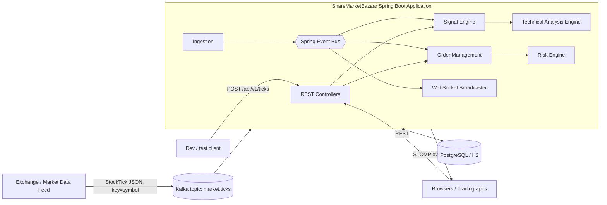
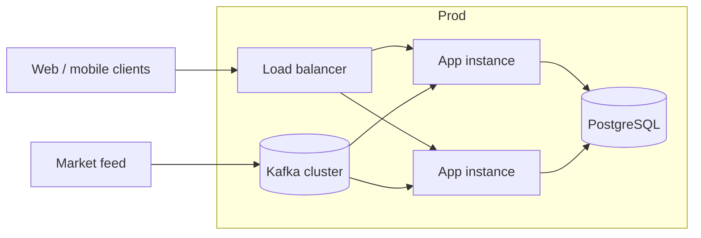
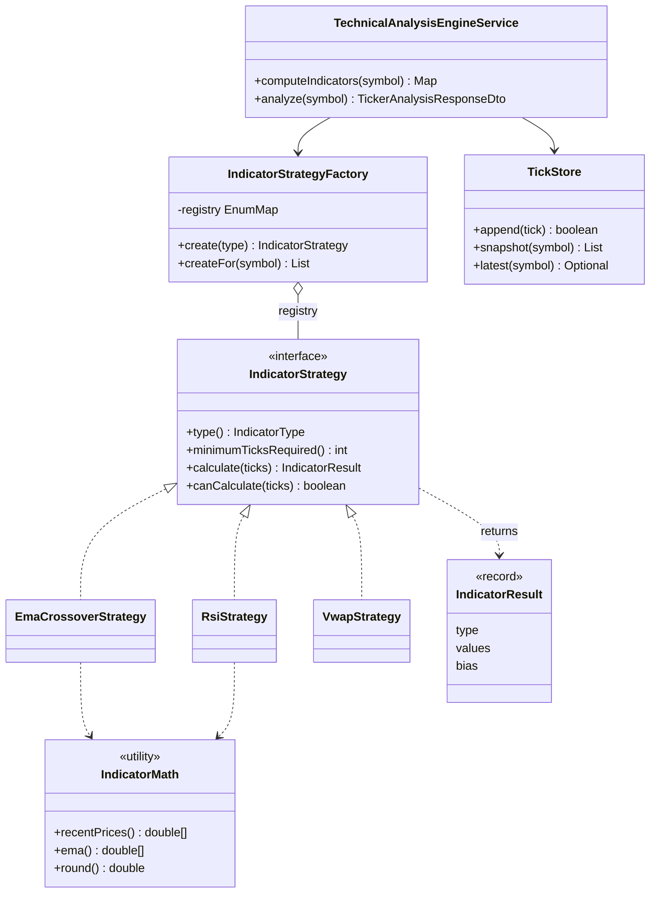
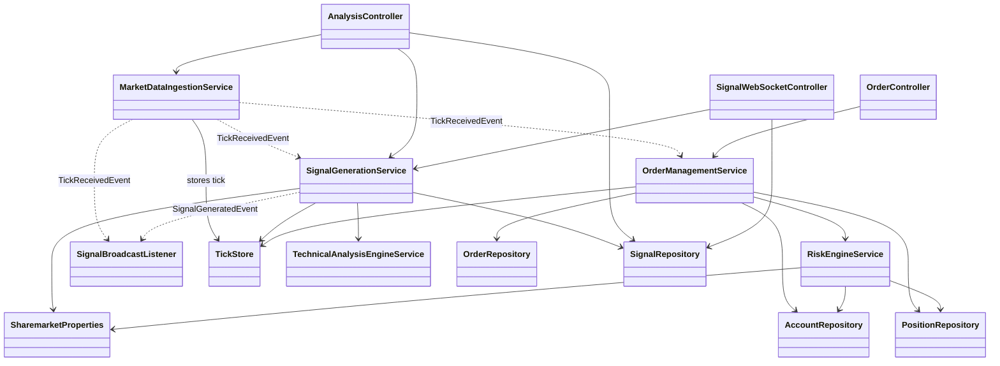
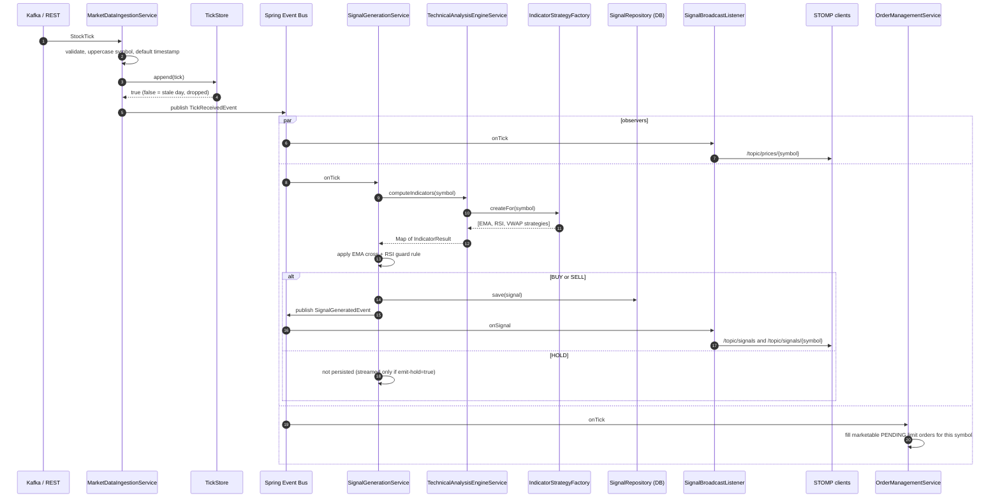
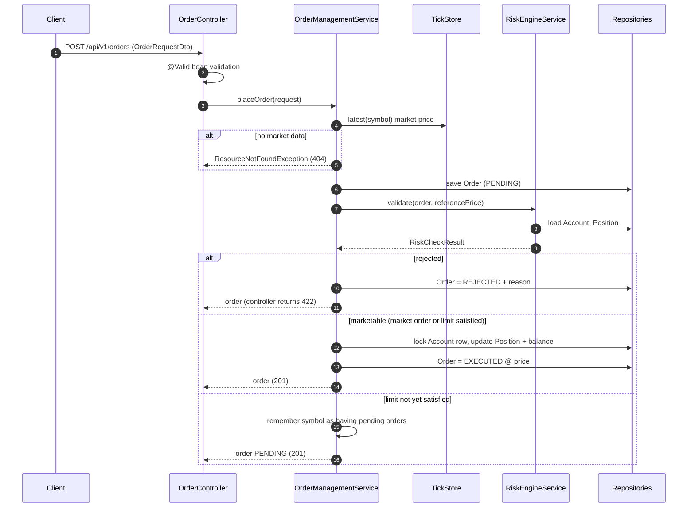
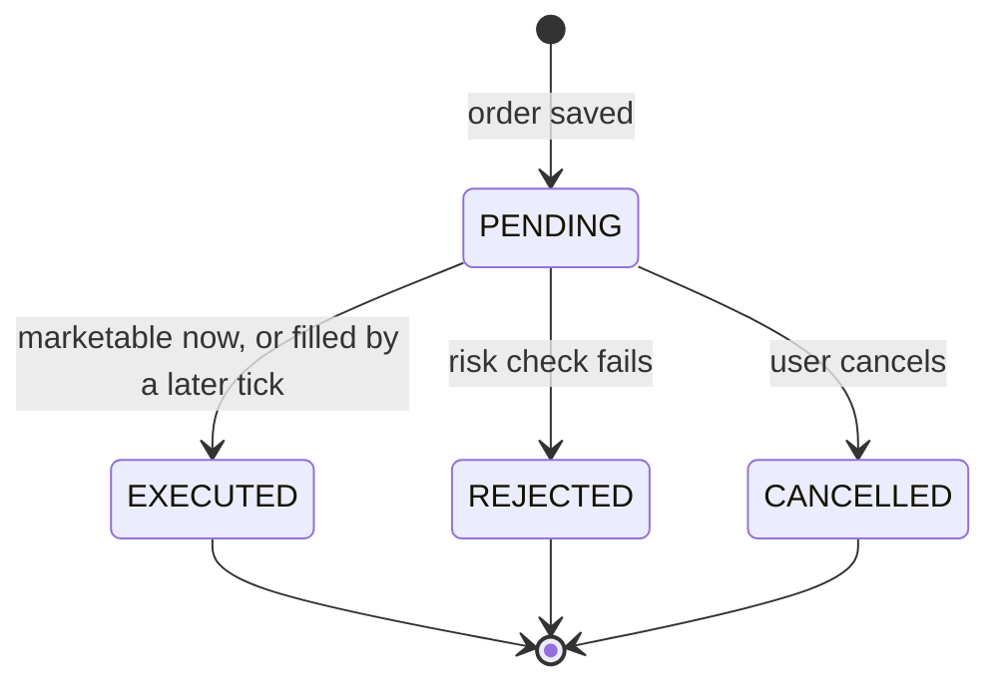
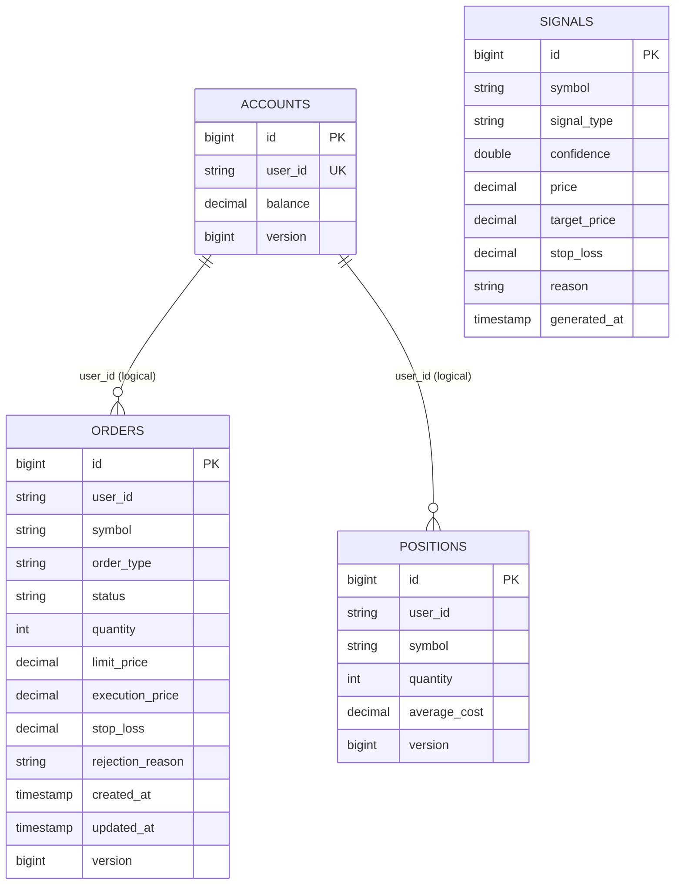
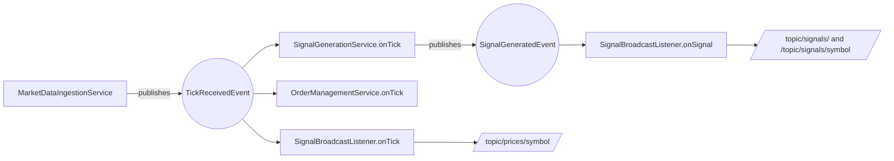

# ShareMarketBazaar

> A real-time **stock market analysis and trade-execution platform** built with **Java 17, Spring Boot 3, Kafka, WebSocket/STOMP and JPA**.
> It ingests live price ticks, calculates technical indicators (EMA, RSI, VWAP), generates **BUY / SELL / HOLD** signals, validates orders through a **pre-trade risk engine**, executes them in an **order management system**, and streams everything live to clients.

   

> ⚠️ **Disclaimer:** This is an educational / engineering project. Signals are produced by simple textbook indicators and are **not financial advice**. Do not trade real money based on them.

---

## Table of Contents

1. [What does this project do? (in plain English)](#1-what-does-this-project-do-in-plain-english)
2. [Stock market basics you need (beginner friendly)](#2-stock-market-basics-you-need-beginner-friendly)
3. [The technical analysis techniques implemented](#3-the-technical-analysis-techniques-implemented)
4. [Tech stack](#4-tech-stack)
5. [High-Level Design (HLD)](#5-high-level-design-hld)
6. [Low-Level Design (LLD)](#6-low-level-design-lld)
7. [End-to-end workflow, step by step](#7-end-to-end-workflow-step-by-step)
8. [Class-by-class reference](#8-class-by-class-reference)
9. [How the classes relate to each other](#9-how-the-classes-relate-to-each-other)
10. [Configuration reference](#10-configuration-reference)
11. [API reference (REST + WebSocket)](#11-api-reference-rest--websocket)
12. [Running the project](#12-running-the-project)
13. [Testing](#13-testing)
14. [Design decisions, concurrency & error handling](#14-design-decisions-concurrency--error-handling)
15. [Known limitations & roadmap](#15-known-limitations--roadmap)
16. [Project structure](#16-project-structure)

---

## 1. What does this project do? (in plain English)

Imagine a stock exchange publishing a message every time a share trades: *"TCS traded at ₹3,500.25, 1,200 shares"*. That message is called a **tick**.

ShareMarketBazaar listens to that stream of ticks and, for every tick:

1. **Remembers** it (per stock, for the trading day).
2. **Calculates indicators** – mathematical summaries of the recent price history that traders use to judge trend and momentum.
3. **Decides** whether the pattern says *buy*, *sell* or *hold*, and proposes a **target price** and **stop-loss**.
4. **Pushes** the price and signal live to any connected browser/app.
5. **Lets a user place orders**. Each order passes a **risk check** (enough money? too big? sensible stop-loss?) before the **order system** executes it and updates the user's cash and holdings.

```text
 Exchange ticks ──► Ingest ──► Store ──► Indicators ──► Signal ──► Live stream (WebSocket)
                                │                         │
                                └────────► Order matching ◄┘            User ──► Risk check ──► Order ──► Account/Position
```

---

## 2. Stock market basics you need (beginner friendly)

| Term | Meaning | Example |
|------|---------|---------|
| **Symbol / Ticker** | Short code identifying a stock | `TCS`, `RELIANCE`, `INFY` |
| **Tick** | One trade/price update: symbol + price + volume + time | `TCS, ₹3500.25, 1200 shares, 10:15:03` |
| **Price** | Last traded price per share | ₹3500.25 |
| **Volume** | Number of shares traded in that tick | 1200 |
| **Trading day** | The market session (here: boundary is midnight in `Asia/Kolkata`) | 4 Oct 2026 |
| **Bullish / Bearish** | Expecting price to rise / fall | – |
| **Long position** | You own shares and profit if the price rises | Hold 10 TCS |
| **Short selling** | Selling shares you don't own (**not allowed** in this app) | – |
| **Market order** | Buy/sell immediately at the current price | Buy 10 TCS now |
| **Limit order** | Buy only at *this price or lower* / sell only at *this price or higher* | Buy TCS at ≤ ₹3,480 |
| **Marketable limit** | A limit order whose condition is already true, so it fills right away | Limit buy ₹3,520 when price is ₹3,500 |
| **Stop-loss** | A safety price: if the trade goes wrong, exit before losing too much | Bought at 1000, stop at 985 (−1.5 %) |
| **Target price** | The profit-taking level | Bought at 1000, target 1030 (+3 %) |
| **Notional (order value)** | price × quantity | 992.5 × 10 = 9,925 |
| **Average cost** | Weighted average buy price of what you hold | See [§8](#8-class-by-class-reference) `OrderManagementService` |

---

## 3. The technical analysis techniques implemented

Technical analysis tries to read the *market's behaviour* from price and volume history. We implement three classic indicators and combine them into one decision rule.

### 3.1 EMA – Exponential Moving Average (trend)

**Idea:** a smoothed price line that reacts faster to recent prices than a simple average.

* **EMA(12)** = *fast* line (reacts quickly)
* **EMA(26)** = *slow* line (shows the bigger trend)

**Formula**

```
k      = 2 / (period + 1)
EMA[t] = price[t] × k + EMA[t-1] × (1 − k)
```

The first EMA value is *seeded* with a simple average (SMA) of the first `period` prices.

**Reading it (EMA crossover)**

| Event | Meaning | Name |
|-------|---------|------|
| Fast line moves **above** slow line | Recent prices are rising faster than the trend → bullish | **Golden cross** → potential **BUY** |
| Fast line moves **below** slow line | Recent prices are falling faster than the trend → bearish | **Death cross** → potential **SELL** |

```text
price
  │        slow EMA(26) ─────────
  │   ╲  fast EMA(12) ╱╲   ← fast crosses ABOVE slow here = golden cross (BUY idea)
  │    ╲_____________╱
  └──────────────────────────────► time
```

> Needs **27 ticks** (26 to seed the slow EMA + 1 extra to compare "previous" vs "now" and detect a *fresh* cross).

### 3.2 RSI – Relative Strength Index (momentum / overheating)

**Idea:** measures how strong recent gains are compared to recent losses on a **0–100** scale.

**Formula (Wilder's smoothing, 14 periods)**

```
change      = price[t] − price[t-1]
avgGain     = smoothed average of positive changes
avgLoss     = smoothed average of negative changes (as positive numbers)
RS          = avgGain / avgLoss
RSI         = 100 − 100 / (1 + RS)
Wilder step : avg = (previousAvg × 13 + currentValue) / 14
```

| RSI value | Interpretation |
|-----------|----------------|
| **≥ 70** | **Overbought** – price rose too fast, a pullback is likelier |
| **≤ 30** | **Oversold** – price fell too fast, a bounce is likelier |
| 30 – 70 | Normal |

Edge cases handled: no losses at all → RSI = 100; no movement at all → RSI = 50.

> Needs **15 ticks** (14 changes).

### 3.3 VWAP – Volume-Weighted Average Price (fair value of the day)

**Idea:** the *average price paid today*, where heavier trades count more.

```
VWAP = Σ(price × volume) / Σ(volume)          (cumulative since the start of the trading day)
```

Example: 100 shares at ₹100 and 300 shares at ₹110 → `(100·100 + 110·300) / 400 =` **₹107.5**.

* Price **above** VWAP → buyers are in control (bullish).
* Price **below** VWAP → sellers are in control (bearish).

The window **resets at every new trading day**, which is what makes it *intraday* VWAP. Needs **1 tick**.

### 3.4 The combined signal rule (EMA trigger + RSI guard + VWAP confirmation)

A crossover alone gives many false alarms, so RSI acts as a **guard** that vetoes trades into an already-overheated move, and VWAP adds **confidence**.

| Condition on the latest tick | Result |
|------------------------------|--------|
| Golden cross **and** RSI < 70 | **BUY** |
| Golden cross **but** RSI ≥ 70 | **HOLD** – "blocked by RSI guard" (chasing an overbought rally) |
| Death cross **and** RSI > 30 | **SELL** |
| Death cross **but** RSI ≤ 30 | **HOLD** – "blocked by RSI guard" (selling into an oversold bottom) |
| No cross / not enough data | **HOLD** |

**Risk levels attached to BUY/SELL** (configurable, default 1.5 % / 3 %):

| | BUY | SELL |
|---|-----|------|
| Stop-loss | price × (1 − 1.5 %) | price × (1 + 1.5 %) |
| Target | price × (1 + 3 %) | price × (1 − 3 %) |

**Confidence score (0–1):**
`0.55 base` + up to `0.25` depending on how far RSI is from the guard limit (more room = more confident) + `0.10` if price is on the correct side of VWAP.

#### Worked example (this is exactly what the Postman BUY scenario produces)

Price falls from 1000 to 985 in 30 steps of −0.5 (fast EMA drops *below* slow EMA), then rises +0.5 per tick. On tick #46 (price **992.5**):

| Indicator | Value | Reading |
|-----------|-------|---------|
| EMA(12) | 990.1989 | just above ↓ |
| EMA(26) | 990.1905 | → **golden cross happened on this tick** |
| RSI(14) | ≈ 67.1 | below 70 → guard passes |
| Signal | **BUY**, stop-loss 977.6125, target 1022.275 | |

If the rebound had been steeper (+1.5/tick) RSI would be ≈ 74 → the same cross is **blocked** and the signal is HOLD.

---

## 4. Tech stack

| Layer | Technology | Why it is used here |
|-------|-----------|---------------------|
| Language | **Java 17** | Records, modern syntax, LTS |
| Framework | **Spring Boot 3.3.5** | Auto-configuration, DI, production-ready defaults |
| REST | **Spring Web (MVC)** | Analysis & order APIs |
| Messaging | **Spring for Apache Kafka** | High-throughput, ordered (per symbol key) tick ingestion; consumer groups for scale |
| Real-time push | **Spring WebSocket + STOMP (SockJS)** | Live prices and signals to browsers |
| Persistence | **Spring Data JPA / Hibernate** | Orders, signals, accounts, positions |
| Database | **PostgreSQL** (prod) · **H2 in-memory** (dev/test, PostgreSQL mode) | Profile-switchable |
| Validation | **Jakarta Bean Validation** | Input guards on ticks & orders |
| Serialization | **Jackson** | JSON for Kafka, REST, WebSocket; Java-time support |
| Boilerplate | **Lombok** | `@Builder`, `@Getter`, `@RequiredArgsConstructor`, `@Slf4j` |
| Ops | **Spring Boot Actuator** | `/actuator/health`, metrics |
| Build | **Maven** | Dependency + packaging |
| Testing | **Postman + Newman**, `spring-boot-starter-test`, `spring-kafka-test` | See [§13](#13-testing) |

---

## 5. High-Level Design (HLD)

### 5.1 System context



### 5.2 Logical components (modules)

| # | Module | Responsibility | Main classes |
|---|--------|----------------|--------------|
| a | **Ingestion** | Receive, validate, normalise and store ticks; announce them | `MarketDataIngestionService`, `TickStore` |
| b | **Technical Indicator Engine** | Compute EMA/RSI/VWAP using pluggable strategies | `TechnicalAnalysisEngineService`, `IndicatorStrategy`, `IndicatorStrategyFactory` |
| c | **Signal Generation** | Turn indicators into BUY/SELL/HOLD with target & stop-loss | `SignalGenerationService` |
| d | **Pre-Trade Risk Engine** | Approve or reject an order before execution | `RiskEngineService` |
| e | **Order Management System (OMS)** | Order lifecycle, execution, settlement, limit-order matching | `OrderManagementService` |
| f | **API / Streaming** | REST + STOMP interfaces | `AnalysisController`, `OrderController`, `SignalWebSocketController`, `SignalBroadcastListener` |
| g | **Persistence** | Durable state | JPA entities + repositories |
| h | **Cross-cutting** | Config, errors, seed data | `SharemarketProperties`, `GlobalExceptionHandler`, `DataInitializer` |

### 5.3 Architectural style

* **Event-driven, modular monolith.** Modules communicate through Spring application events (`TickReceivedEvent`, `SignalGeneratedEvent`) rather than calling each other directly – so adding a new reaction to a tick (e.g. an alert engine) needs **zero** change to existing code. Each module could later be extracted to a microservice by replacing the in-process event with a Kafka topic.
* **Hot path in memory, cold path in database.** Ticks (high volume, short-lived) live in memory in `TickStore`; business records (orders, signals, accounts, positions) are persisted.
* **Layered:** Controller → Service → Repository, with the analytics core isolated in its own package.

### 5.4 Data stores

| Data | Store | Reason |
|------|-------|--------|
| Ticks (today's window per symbol) | In-memory `ConcurrentHashMap<symbol, Deque>` | Microsecond access, needed on every tick |
| Orders, Signals, Accounts, Positions | PostgreSQL / H2 via JPA | Durability, transactions, audit |
| Tick transport | Kafka | Ordered, replayable, horizontally scalable stream |

### 5.5 Deployment view



> With several instances, partition Kafka by symbol (the message **key**) so every tick of one symbol reaches the same consumer, keeping the in-memory window and ordering correct. See [limitations](#15-known-limitations--roadmap) for what is needed to make the in-memory window cluster-safe.

### 5.6 Non-functional characteristics

| Concern | How it is handled |
|---------|-------------------|
| **Latency** | In-memory tick window, synchronous in-process events, bounded indicator lookback (250 ticks) |
| **Ordering** | Kafka key = symbol ⇒ per-symbol order; per-symbol lock in `TickStore` |
| **Resilience** | `ErrorHandlingDeserializer` + try/catch per tick – one bad message never stalls a partition |
| **Consistency** | Order execution inside DB transactions; pessimistic lock on the account row; `@Version` optimistic locking on entities |
| **Observability** | Actuator health/metrics, structured SLF4J logs |
| **Configurability** | Everything tunable under `sharemarket.*` without code changes |

---

## 6. Low-Level Design (LLD)

### 6.1 Package layout and responsibilities

```
com.sharemarketbazaar
├── Application              bootstrap
├── config/                  properties binding, WebSocket broker, seed data
├── model/                   domain objects + JPA entities
├── repository/              Spring Data JPA interfaces
├── dto/                     API-facing request/response objects
├── event/                   Observer pattern events + broadcast listener
├── exception/               custom exception + global REST error mapping
├── analytics/               Strategy + Factory patterns, tick store, engine
├── service/                 ingestion, signal, risk, OMS business logic
└── controller/              REST + STOMP endpoints
```

### 6.2 Design patterns used

| Pattern | Where | Why |
|---------|-------|-----|
| **Strategy** | `IndicatorStrategy` ← `EmaCrossoverStrategy`, `RsiStrategy`, `VwapStrategy` | Each algorithm is an interchangeable, independently testable unit. Add a MACD class without touching the engine. |
| **Factory** | `IndicatorStrategyFactory` | Chooses which strategies run for which ticker, driven by config (`ticker-indicators`). |
| **Observer / Event-driven** | `TickReceivedEvent`, `SignalGeneratedEvent` + `@EventListener` methods | Decouples publisher from subscribers (signal engine, OMS, WebSocket). |
| **Builder** | `Order`, `Signal`, `Account`, `Position`, `StockTick`, `OrderRequestDto`, `TradeSignalDto`, `TickerAnalysisResponseDto` (Lombok) | Readable construction of objects with many optional fields. |
| **DTO** | `dto/*` | API contract separate from persistence model (e.g. `Signal` entity vs `TradeSignalDto`). |
| **Repository** | `repository/*` | Persistence abstraction. |
| **Template/Pipeline-style service** | `OrderManagementService.placeOrder` | Fixed steps: price → persist → risk → execute/rest. |
| **Value objects (records)** | `IndicatorResult`, `RiskCheckResult`, events | Immutable data carriers. |

### 6.3 Class diagram – analytics core (Strategy + Factory)



### 6.4 Class diagram – services and flow of dependencies



*(solid arrow = direct dependency/injection; dotted arrow = event-driven communication)*

### 6.5 Sequence – tick to live signal



### 6.6 Sequence – placing an order



### 6.7 Order state machine



A market order is created `PENDING` and moves to `EXECUTED`/`REJECTED` **within the same database transaction**, so clients never observe the intermediate state.

### 6.8 Database model (ER)



* `positions` has a unique constraint on `(user_id, symbol)`.
* Relationships are *logical* (by `user_id`), not enforced foreign keys.
* The `Order` entity is named `TradeOrder` in JPQL because `ORDER` is a reserved SQL word; the table is `orders`.
* Indexes: `orders(user_id)`, `orders(symbol,status)`, `signals(symbol,generatedAt)`.

### 6.9 Threading model

* Kafka listener thread(s) → `onMessage` → `ingest` → synchronous event dispatch → all observers run **on that same thread** (so per-symbol ordering is preserved end to end).
* `TickStore` synchronises on the individual symbol's deque, so different symbols never block each other.
* REST threads read `TickStore` through `snapshot()` (defensive copy) and never hold a lock while computing.

---

## 7. End-to-end workflow, step by step

### Phase A – Market data arrives

1. A producer publishes a JSON `StockTick` to Kafka topic `market.ticks` with the **symbol as the message key**
   (or a developer calls `POST /api/v1/ticks` – the same code path).
2. `MarketDataIngestionService.onMessage` receives it. If the JSON was invalid, the `ErrorHandlingDeserializer` yields `null` and the message is skipped with a warning.
3. `ingest()` validates (`@NotBlank symbol`, `@Positive price`, `@PositiveOrZero volume`), upper-cases the symbol, and fills in the timestamp if missing.
4. `TickStore.append()` stores it:
   * a tick from an **older trading day** than the newest stored one is dropped;
   * a tick from a **newer day** clears the symbol's window first (VWAP restarts);
   * the window is capped at `max-ticks-per-symbol`.
5. A `TickReceivedEvent` is published.

### Phase B – Observers react to the tick (in parallel responsibilities)

| Observer | What it does |
|----------|--------------|
| `SignalBroadcastListener.onTick` | Pushes the raw tick to `/topic/prices/{symbol}` |
| `SignalGenerationService.onTick` | Runs indicators → signal (Phase C) |
| `OrderManagementService.onTick` | If this symbol has resting limit orders, fills those whose limit is now satisfied (Phase E) |

### Phase C – Indicators and signal

1. `TechnicalAnalysisEngineService` asks `IndicatorStrategyFactory.createFor(symbol)` which strategies apply (per-ticker override or defaults).
2. For each strategy with enough data (`canCalculate`) it calls `calculate(ticks)`; strategies lacking data are simply skipped (*warm-up*).
3. `SignalGenerationService.evaluate` applies the rule in [§3.4](#34-the-combined-signal-rule-ema-trigger--rsi-guard--vwap-confirmation), computes confidence, stop-loss and target.
4. A **BUY/SELL** is saved to the `signals` table and a `SignalGeneratedEvent` is published → `SignalBroadcastListener.onSignal` streams it to `/topic/signals` and `/topic/signals/{symbol}`.
   A **HOLD** is *not* stored (to avoid millions of useless rows) and is streamed only if `emit-hold=true`.

### Phase D – A user places an order

1. `POST /api/v1/orders` → bean validation (`OrderRequestDto`).
2. `OrderManagementService.placeOrder`:
   1. finds the current market price (latest tick) – no tick ⇒ `404`;
   2. saves the order as `PENDING`;
   3. picks the **reference price**: the limit price if given, else market price;
   4. calls `RiskEngineService.validate` (below);
   5. rejected ⇒ status `REJECTED` + reason, HTTP **422**;
   6. approved & marketable ⇒ `execute()` at the **market price**, HTTP **201**;
   7. approved & limit not yet reachable ⇒ stays `PENDING`, symbol added to the "has pending orders" set, HTTP **201**.

**Risk rules** (all violations are collected and returned together):

| Rule | BUY | SELL |
|------|-----|------|
| Account exists | ✔ | ✔ |
| Order value ≤ `max-order-value` | ✔ | ✔ |
| Sufficient cash balance | ✔ | – |
| Position after trade ≤ `max-position-quantity` | ✔ | – |
| Stop-loss **mandatory**, below price, distance within 0.1 %–10 % | ✔ | optional (must be above price if given) |
| Quantity ≤ shares held (no short selling) | – | ✔ |

### Phase E – Execution and settlement (`execute`)

1. Lock the user's `Account` row (`PESSIMISTIC_WRITE`) so concurrent fills cannot corrupt the balance.
2. **BUY:** `newAvgCost = (oldAvg × oldQty + price × qty) / (oldQty + qty)`; quantity increases; cash decreases by `price × qty`.
3. **SELL:** quantity decreases (avg cost resets to 0 when flat); cash increases by `price × qty`.
4. Save position and account; mark order `EXECUTED` with `executionPrice`.

**Resting limit orders:** every subsequent tick of that symbol re-checks pending orders. A BUY limit fills when `tickPrice ≤ limit`; a SELL limit fills when `tickPrice ≥ limit`. Risk is **re-run at fill time** (balance may have changed). Each fill runs in its **own transaction** so one failure cannot affect other orders.

### Phase F – Clients consume results

* **REST:** `GET /api/v1/analysis/{symbol}` returns indicators + current signal; `.../signals` returns the last 20 persisted signals; order endpoints return order state.
* **WebSocket/STOMP:** live prices, live signals, a "latest signal" snapshot on subscribe, and on-demand analysis replies.

### One-picture summary

```text
Tick ─► validate ─► TickStore ─► TickReceivedEvent ─┬─► WebSocket price feed
                                                     ├─► Indicators ─► Signal rule ─► DB + SignalGeneratedEvent ─► WebSocket signals
                                                     └─► Resting limit orders ─► Risk ─► Execute

User order ─► validate ─► price lookup ─► save PENDING ─► Risk ─► REJECTED | EXECUTED | stays PENDING
```

---

## 8. Class-by-class reference

Legend: **Pattern** column shows design-pattern role where relevant.

### 8.1 Entry point

| Class | Purpose |
|-------|---------|
| `Application` | Spring Boot `main`. `@SpringBootApplication` scans the package; `@ConfigurationPropertiesScan` registers `SharemarketProperties`. |

### 8.2 `config` package

| Class | Purpose | Collaborates with |
|-------|---------|-------------------|
| `SharemarketProperties` | Type-safe binding of the whole `sharemarket.*` YAML tree into nested classes `Kafka`, `Analysis`, `SignalRules`, `RiskLimits`. Single source of truth for thresholds. | Read by `TickStore`, `IndicatorStrategyFactory`, `SignalGenerationService`, `RiskEngineService` |
| `WebSocketConfig` | Enables the STOMP message broker: endpoint `/ws` (SockJS), simple broker destinations `/topic` & `/queue`, app prefix `/app`, user prefix `/user`. | `SignalWebSocketController`, `SignalBroadcastListener` |
| `DataInitializer` | `CommandLineRunner` that seeds the demo account `demo-user` with ₹1,000,000 on startup (idempotent). | `AccountRepository` |

### 8.3 `model` package (domain + entities)

| Class | Purpose | Key fields |
|-------|---------|------------|
| `StockTick` | One market data tick; also the Kafka message payload. Validated with Bean Validation. | `symbol, price, volume, timestamp` |
| `Order` | JPA entity (`TradeOrder`/table `orders`). Holds enums `OrderType {BUY,SELL}` and `OrderStatus {PENDING,EXECUTED,REJECTED,CANCELLED}`. Auto-sets `createdAt/updatedAt` via `@PrePersist/@PreUpdate`; `@Version` for optimistic locking. | `userId, symbol, type, status, quantity, limitPrice (null = market), executionPrice, stopLoss, rejectionReason` |
| `Signal` | JPA entity for a generated signal; enum `SignalType {BUY,SELL,HOLD}`. | `symbol, type, confidence (0-1), price, targetPrice, stopLoss, reason, generatedAt` |
| `Account` | A user's cash balance; `@Version` guards concurrent edits. | `userId (unique), balance` |
| `Position` | Net **long** holding of one symbol for one user; unique on (user, symbol). | `userId, symbol, quantity, averageCost` |

### 8.4 `repository` package

| Interface | Purpose | Notable methods |
|-----------|---------|-----------------|
| `OrderRepository` | Order persistence | `findByUserIdOrderByCreatedAtDesc`, `findBySymbolAndStatus`, `findDistinctSymbolsByStatus` (rebuilds the pending-symbol cache on startup) |
| `SignalRepository` | Signal persistence | `findTop20BySymbolOrderByGeneratedAtDesc`, `findFirstBySymbolOrderByGeneratedAtDesc` |
| `AccountRepository` | Account persistence | `findByUserId`, `findByUserIdForUpdate` (**pessimistic write lock**) |
| `PositionRepository` | Position persistence | `findByUserIdAndSymbol` |

### 8.5 `dto` package

| Class | Purpose |
|-------|---------|
| `OrderRequestDto` | Inbound order. Validates `userId`, `symbol` pattern, `type`, `quantity ≥ 1`, optional positive `limitPrice` and `stopLoss`. No `limitPrice` ⇒ market order. |
| `TradeSignalDto` | Immutable outbound signal (REST + WebSocket). Static `from(Signal)` converter. Built with the Builder pattern. |
| `TickerAnalysisResponseDto` | Immutable snapshot for one ticker: last price/time, tick count, `ema12, ema26, rsi14, vwap`, full indicator map, current signal. `toBuilder` lets the service attach the signal after computing the analysis. |

### 8.6 `event` package (Observer pattern)

| Class | Purpose |
|-------|---------|
| `TickReceivedEvent` (record) | "A tick has been validated and stored." Observers: signal engine, OMS, WebSocket broadcaster. |
| `SignalGeneratedEvent` (record) | "A signal was emitted." Observer: WebSocket broadcaster. |
| `SignalBroadcastListener` | Component with two `@EventListener`s that forward ticks and signals to STOMP topics through `SimpMessagingTemplate`. |

### 8.7 `exception` package

| Class | Purpose |
|-------|---------|
| `ResourceNotFoundException` | Thrown when a symbol has no data, or an order/account doesn't exist ⇒ **404**. |
| `GlobalExceptionHandler` | `@RestControllerAdvice` converting exceptions to RFC 7807 `ProblemDetail` JSON: validation ⇒ 400 (with per-field `errors`), malformed JSON ⇒ 400, `IllegalStateException` ⇒ 409, optimistic-lock failure ⇒ 409, anything else ⇒ 500 (logged, message hidden). |

### 8.8 `analytics` package (the technical-analysis core)

| Class | Purpose | Notes |
|-------|---------|-------|
| `IndicatorType` | Enum `EMA_CROSSOVER, RSI, VWAP`. Used as config values and registry keys. | |
| `IndicatorResult` (record) | Immutable output: `type`, a `Map<String,Double>` of named values, and a `Bias {BULLISH, BEARISH, NEUTRAL}`. `value(key)` fails fast if a value is missing. | |
| `IndicatorStrategy` (interface) | **Strategy contract**: `type()`, `minimumTicksRequired()`, `calculate(ticks)`, default `canCalculate(ticks)`. | Pattern: Strategy |
| `IndicatorMath` (package-private utility) | Shared maths: take the last 250 prices, compute an EMA array (SMA-seeded), rounding to 4 dp. | Used by EMA & RSI |
| `EmaCrossoverStrategy` | EMA(12) vs EMA(26). Outputs `ema12, ema26, spread, crossover` (+1 golden, −1 death, 0 none on the *latest* tick). Needs 27 ticks. Bias from the sign of the spread. | |
| `RsiStrategy` | RSI(14) with Wilder smoothing; handles zero-loss / zero-move edge cases. Bias is mean-reversion style (≥70 bearish, ≤30 bullish). Needs 15 ticks. | |
| `VwapStrategy` | Cumulative `Σ(p·v)/Σ(v)`; outputs `vwap` and `priceVsVwapPct`. Falls back to last price if total volume is 0. Bias = price vs VWAP. Needs 1 tick. | |
| `IndicatorStrategyFactory` | **Factory**: collects all `IndicatorStrategy` beans into an `EnumMap`; `create(type)` returns one; `createFor(symbol)` returns the configured list for that ticker (override → else defaults). | Pattern: Factory |
| `TickStore` | Thread-safe in-memory per-symbol deque. `append` (day-rollover and stale-tick logic, size cap), `snapshot` (defensive copy), `latest`. | |
| `TechnicalAnalysisEngineService` | Orchestrator: asks the factory for strategies, runs those with enough data, returns an `EnumMap<IndicatorType, IndicatorResult>`; `analyze()` builds `TickerAnalysisResponseDto` (404 if no data). | |

### 8.9 `service` package

| Class | Purpose | Key methods |
|-------|---------|-------------|
| `MarketDataIngestionService` | **Entry for all ticks.** Kafka `@KafkaListener` (auto-start controlled by `sharemarket.kafka.enabled`) and REST both call `ingest()`; validates, normalises, stores, publishes `TickReceivedEvent`. Bad ticks are logged and discarded so the partition never blocks. | `onMessage`, `ingest` |
| `SignalGenerationService` | **Signal engine.** Observer of `TickReceivedEvent`. Applies EMA-cross + RSI-guard rule, computes confidence/stop-loss/target, persists BUY/SELL, publishes `SignalGeneratedEvent`. Also serves on-demand evaluation for the APIs. | `onTick`, `evaluate`, `analyzeWithSignal` |
| `RiskEngineService` | **Pre-trade risk.** Returns `RiskCheckResult(approved, violations)`; collects *all* violations in one pass. | `validate` |
| `OrderManagementService` | **OMS.** Place / cancel / get / list orders; execute and settle; match resting limit orders on each tick (observer); keeps a `symbolsWithPending` set so ticks for symbols without pending orders never touch the DB; rebuilds that set on `ApplicationReadyEvent`. | `placeOrder`, `cancelOrder`, `onTick`, `execute` |

### 8.10 `controller` package

| Class | Protocol | Endpoints / destinations |
|-------|----------|--------------------------|
| `AnalysisController` | REST | `GET /api/v1/analysis/{symbol}`, `GET /api/v1/analysis/{symbol}/signals`, `POST /api/v1/ticks` |
| `OrderController` | REST | `POST /api/v1/orders` (201 / **422** when risk-rejected), `GET /api/v1/orders/{id}`, `GET /api/v1/orders?userId=`, `DELETE /api/v1/orders/{id}?userId=` |
| `SignalWebSocketController` | STOMP | `SUBSCRIBE /app/signals/latest/{symbol}` (snapshot), `SEND /app/analysis/{symbol}` → reply `/user/queue/analysis`, errors → `/user/queue/errors` |

### 8.11 Non-Java artefacts

| File | Purpose |
|------|---------|
| `pom.xml` | Maven build, Spring Boot parent 3.3.5, dependencies |
| `src/main/resources/application.yml` | Common config + `h2` and `postgres` profile documents |
| `postman/ShareMarketBazaar.postman_collection.json` | 42 automated API tests |
| `postman/websocket-test.html` | Browser STOMP tester |
| `docs/TESTING_GUIDE.md` | Step-by-step test walkthrough |

---

## 9. How the classes relate to each other

### 9.1 Dependency map (who uses whom)

| Class | Depends on (injected) | Used by |
|-------|----------------------|---------|
| `MarketDataIngestionService` | `TickStore`, `ApplicationEventPublisher`, `Validator` | Kafka, `AnalysisController` |
| `TickStore` | `SharemarketProperties` | Ingestion, Analysis engine, Signal service, OMS |
| `IndicatorStrategyFactory` | all `IndicatorStrategy` beans, `SharemarketProperties` | `TechnicalAnalysisEngineService` |
| `TechnicalAnalysisEngineService` | `TickStore`, `IndicatorStrategyFactory` | `SignalGenerationService` |
| `SignalGenerationService` | engine, `TickStore`, `SignalRepository`, event publisher, properties | Event bus, `AnalysisController`, `SignalWebSocketController` |
| `SignalBroadcastListener` | `SimpMessagingTemplate` | Event bus |
| `RiskEngineService` | `AccountRepository`, `PositionRepository`, properties | `OrderManagementService` |
| `OrderManagementService` | 3 repositories, `RiskEngineService`, `TickStore`, `TransactionTemplate` | `OrderController`, Event bus |
| `AnalysisController` | `SignalGenerationService`, `SignalRepository`, `MarketDataIngestionService` | HTTP |
| `OrderController` | `OrderManagementService` | HTTP |
| `SignalWebSocketController` | `SignalGenerationService`, `SignalRepository` | STOMP |
| `GlobalExceptionHandler` | – | All controllers |

### 9.2 Event relationships



### 9.3 Layering rules followed

* **Controllers** never contain business logic – they validate, delegate, and shape the HTTP status.
* **Services** never know about HTTP; they throw domain exceptions that `GlobalExceptionHandler` maps.
* **Analytics strategies** know nothing about Spring MVC, the DB, or events – they are pure functions of `List<StockTick>`.
* **Entities** are not exposed for signals (a DTO is used) but `Order` is returned directly for brevity.

### 9.4 Reading guide – "I want to change X, which class do I touch?"

| Goal | Where |
|------|-------|
| Add a new indicator (e.g., MACD) | New `@Component implements IndicatorStrategy` + new `IndicatorType` value; enable via YAML. No other code changes. |
| Change when a signal fires | `SignalGenerationService.evaluate` |
| Change risk limits | YAML `sharemarket.risk.*` or `RiskEngineService` for new rules |
| Different indicators for one stock | YAML `sharemarket.analysis.ticker-indicators` |
| New live feed (e.g., alerts) | New `@EventListener` on `TickReceivedEvent` / `SignalGeneratedEvent` |
| Add fees/brokerage | `OrderManagementService.execute` |

---

## 10. Configuration reference

All keys live in `src/main/resources/application.yml`.

| Key | Default | Description |
|-----|---------|-------------|
| `spring.profiles.default` | `h2` | `h2` (dev) or `postgres` (prod) |
| `sharemarket.kafka.topic` | `market.ticks` | Topic consumed |
| `sharemarket.kafka.enabled` | `false` (h2) / `true` (postgres); env `KAFKA_ENABLED` | Starts/stops the Kafka listener |
| `sharemarket.analysis.market-zone` | `Asia/Kolkata` | Defines the trading-day boundary (VWAP reset) |
| `sharemarket.analysis.max-ticks-per-symbol` | `50000` | In-memory cap per symbol |
| `sharemarket.analysis.default-indicators` | `[EMA_CROSSOVER, RSI, VWAP]` | Used when no override |
| `sharemarket.analysis.ticker-indicators.<SYMBOL>` | `RELIANCE: [EMA_CROSSOVER, RSI]` | Per-ticker override (Factory input) |
| `sharemarket.signal.stop-loss-pct` | `1.5` | Stop-loss distance |
| `sharemarket.signal.target-pct` | `3.0` | Target distance |
| `sharemarket.signal.rsi-overbought` | `70` | RSI guard for BUY |
| `sharemarket.signal.rsi-oversold` | `30` | RSI guard for SELL |
| `sharemarket.signal.emit-hold` | `false` | Also stream HOLD signals |
| `sharemarket.risk.max-position-quantity` | `5000` | Max shares per symbol per user |
| `sharemarket.risk.max-order-value` | `500000` | Max notional per order |
| `sharemarket.risk.min-stop-loss-pct` / `max-stop-loss-pct` | `0.1` / `10.0` | Allowed BUY stop-loss distance |

**Environment variables (postgres profile):** `DB_HOST`, `DB_PORT`, `DB_NAME`, `DB_USER`, `DB_PASSWORD`, `KAFKA_BOOTSTRAP_SERVERS`, `KAFKA_ENABLED`.

---

## 11. API reference (REST + WebSocket)

Base URL: `http://localhost:8080`

### REST

| Method & path | Body / params | Success | Errors |
|---------------|---------------|---------|--------|
| `POST /api/v1/ticks` | `{"symbol","price","volume","timestamp?"}` | `202` + normalised tick | `400` |
| `GET /api/v1/analysis/{symbol}` | – | `200` `TickerAnalysisResponseDto` | `404` no data |
| `GET /api/v1/analysis/{symbol}/signals` | – | `200` last ≤20 BUY/SELL signals | – |
| `POST /api/v1/orders` | `OrderRequestDto` | `201` EXECUTED/PENDING order | `400` validation, `404` no market data, **`422` risk-rejected** (body is the REJECTED order) |
| `GET /api/v1/orders/{id}` | – | `200` | `404` |
| `GET /api/v1/orders?userId=` | – | `200` newest first | – |
| `DELETE /api/v1/orders/{id}?userId=` | – | `200` CANCELLED | `404` (not found / not owner), `409` not PENDING |
| `GET /actuator/health` | – | `200` | – |

**Sample analysis response**

```json
{
  "symbol": "TCS",
  "lastPrice": 992.5,
  "lastTickAt": "2026-10-04T06:10:00Z",
  "tickCount": 46,
  "ema12": 990.1989,
  "ema26": 990.1905,
  "rsi14": 67.1,
  "vwap": 993.9,
  "indicators": {
    "EMA_CROSSOVER": { "type": "EMA_CROSSOVER", "values": { "ema12": 990.1989, "ema26": 990.1905, "spread": 0.0084, "crossover": 1.0 }, "bias": "BULLISH" },
    "RSI":  { "type": "RSI",  "values": { "rsi": 67.1 }, "bias": "NEUTRAL" },
    "VWAP": { "type": "VWAP", "values": { "vwap": 993.9, "priceVsVwapPct": -0.14 }, "bias": "BEARISH" }
  },
  "signal": { "symbol": "TCS", "signal": "BUY", "confidence": 0.58, "price": 992.5,
              "targetPrice": 1022.275, "stopLoss": 977.6125,
              "reason": "EMA12 crossed above EMA26; RSI 67.1 below overbought 70.0",
              "generatedAt": "2026-10-04T06:10:00.123Z" }
}
```
*(illustrative values)*

**Sample order request**

```json
{ "userId": "demo-user", "symbol": "TCS", "type": "BUY", "quantity": 10, "stopLoss": 977.6 }
```
Add `"limitPrice": 990` for a limit order.

### WebSocket (STOMP over SockJS)

Connect to `http://localhost:8080/ws` (raw WebSocket: `ws://localhost:8080/ws/websocket`).

| Direction | Destination | Payload |
|-----------|-------------|---------|
| Subscribe | `/topic/signals` | every BUY/SELL (and HOLD if enabled) |
| Subscribe | `/topic/signals/{SYMBOL}` | signals for one symbol |
| Subscribe | `/topic/prices/{SYMBOL}` | every tick |
| Subscribe | `/app/signals/latest/{SYMBOL}` | immediate snapshot of latest signal |
| Send | `/app/analysis/{SYMBOL}` | request full analysis |
| Subscribe | `/user/queue/analysis` | reply to the above |
| Subscribe | `/user/queue/errors` | `{ "error": "..." }` |

---

## 12. Running the project

### Prerequisites
JDK 17+, Maven 3.8+ (Docker only if you want a real Kafka/PostgreSQL).

### Option 1 – Local, zero infrastructure (H2, no Kafka)

```bash
git clone https://github.com/coder-stat920715/sharemarketbazaar.git
cd sharemarketbazaar
mvn spring-boot:run
```

* App: <http://localhost:8080> · Health: `/actuator/health`
* H2 console: <http://localhost:8080/h2-console> (JDBC `jdbc:h2:mem:sharemarket`, user `sa`, empty password)
* Seeded account: `demo-user` with balance 1,000,000

Try it:

```bash
curl -X POST localhost:8080/api/v1/ticks -H 'Content-Type: application/json' \
  -d '{"symbol":"TCS","price":3500.25,"volume":1200}'
curl localhost:8080/api/v1/analysis/TCS
curl -X POST localhost:8080/api/v1/orders -H 'Content-Type: application/json' \
  -d '{"userId":"demo-user","symbol":"TCS","type":"BUY","quantity":10,"stopLoss":3450}'
```

> Indicators need history: VWAP 1 tick, RSI 15, EMA crossover 27. Use the Postman collection to load a ready-made BUY/SELL scenario in one click.

### Option 2 – With Kafka

```bash
docker run -d --name kafka -p 9092:9092 apache/kafka:3.8.0
KAFKA_ENABLED=true mvn spring-boot:run
```
Publish keyed JSON to `market.ticks` (see [docs/TESTING_GUIDE.md](docs/TESTING_GUIDE.md#8-optional-testing-the-real-kafka-path)).

### Option 3 – Production profile (PostgreSQL + Kafka)

```bash
export SPRING_PROFILES_ACTIVE=postgres
export DB_HOST=... DB_USER=... DB_PASSWORD=... KAFKA_BOOTSTRAP_SERVERS=...
mvn clean package && java -jar target/sharemarketbazaar-1.0.0.jar
```
For real production replace `ddl-auto: update` with Flyway/Liquibase migrations and `validate`.

---

## 13. Testing

| Asset | Description |
|-------|-------------|
| `postman/ShareMarketBazaar.postman_collection.json` | 42 requests / ~150 assertions: ingestion validation, hand-verifiable indicator maths (VWAP = 107.5, RSI = 100), BUY / SELL / RSI-guard signal scenarios, all risk rejections, limit-order fill & cancel, error cases. Re-runnable without restart (unique symbols per run). |
| `postman/websocket-test.html` | Browser page to exercise every STOMP destination. |
| `docs/TESTING_GUIDE.md` | Step-by-step manual guide, expected results, H2 verification SQL, Kafka test, troubleshooting. |

CLI run:

```bash
npm i -g newman
newman run postman/ShareMarketBazaar.postman_collection.json
```

---

## 14. Design decisions, concurrency & error handling

**Why Strategy + Factory for indicators?** New indicators become new classes, not edits to a growing `if/else`. Per-ticker configuration is a data change (YAML), not a code change.

**Why events instead of direct calls?** `MarketDataIngestionService` doesn't know who cares about a tick. This keeps ingestion fast and simple and makes the system trivially extensible (alerts, auditing, ML features…).

**Why persist only BUY/SELL?** HOLD occurs on nearly every tick – storing it would create enormous, valueless data. The *current* HOLD state is always available on demand from `GET /analysis/{symbol}`.

**Concurrency controls**

| Risk | Control |
|------|---------|
| Two orders settling the same account at once | `PESSIMISTIC_WRITE` lock on the account row + `@Version` |
| Concurrent edits to orders/positions | `@Version` optimistic locking → `409` |
| Interleaved ticks of one symbol | Per-symbol `synchronized` deque + Kafka key ordering |
| One failing limit-order fill harming others | Each fill in its own `TransactionTemplate` transaction |
| Ticks arriving late across midnight | Stale-day ticks dropped; new day clears the window |

**Error handling summary**

| Situation | HTTP | Where |
|-----------|------|-------|
| Bean validation failure | 400 + `errors{field→message}` | `GlobalExceptionHandler` |
| Malformed JSON / illegal argument | 400 | same |
| Unknown symbol / order / no data | 404 | `ResourceNotFoundException` |
| Illegal state (cancel non-pending) | 409 | `IllegalStateException` |
| Concurrent modification | 409 | `OptimisticLockingFailureException` |
| Risk rejection | 422 (order persisted as REJECTED) | `OrderController` |
| Unexpected | 500 (generic message, full stack in logs) | catch-all |

Kafka poison messages are neutralised by `ErrorHandlingDeserializer` + a try/catch in `onMessage`.

---

## 15. Known limitations & roadmap

**Current limitations (be aware before using beyond learning/demo)**

* **Single-node tick window:** `TickStore` is in memory – restart loses it; multiple instances need symbol-partitioned consumers or a shared store (Redis).
* **O(n) indicator recomputation** per tick over the window. At very high rates switch to incremental EMA/RSI/VWAP state (running sums).
* **No authentication/authorisation:** `userId` is supplied by the client. Add Spring Security/JWT and derive the user from the token.
* **Stop-loss/target are advisory:** they are validated and stored but no engine monitors and auto-exits positions yet.
* **Signals do not auto-trade:** orders are placed manually through the API.
* **Pending limit orders don't reserve cash;** balance is re-validated at fill time instead.
* **Long-only:** no short selling, no fees, taxes, slippage or partial fills.
* **WebSocket CORS is `*`** – restrict to your front-end origins in production.
* **Event listeners are synchronous** on the ingest thread; heavy listeners should be made `@Async` or moved to Kafka.
* **`ddl-auto: update`** in the Postgres profile is convenience only.
* **Indicators are classic & lagging** and ignore corporate actions, circuit limits, market hours/holidays.

**Roadmap ideas**

* More indicators: MACD, Bollinger Bands, ATR, Stochastic, Supertrend – each is just one new `IndicatorStrategy`.
* Bar/candle aggregation (1m/5m) instead of raw ticks.
* Stop-loss / target monitor and bracket orders.
* Auto-trading bot consuming `SignalGeneratedEvent`.
* Backtesting engine replaying historical ticks through the same strategies.
* Redis-backed tick window, Flyway migrations, Spring Security, Micrometer + Prometheus/Grafana dashboards, Dockerfile & docker-compose, GitHub Actions CI.

---

## 16. Project structure

```
sharemarketbazaar/
├── pom.xml
├── README.md
├── docs/
│   └── TESTING_GUIDE.md
├── postman/
│   ├── ShareMarketBazaar.postman_collection.json
│   └── websocket-test.html
└── src/main/
    ├── resources/application.yml
    └── java/com/sharemarketbazaar/
        ├── Application.java
        ├── config/        SharemarketProperties · WebSocketConfig · DataInitializer
        ├── model/         StockTick · Order · Signal · Account · Position
        ├── repository/    OrderRepository · SignalRepository · AccountRepository · PositionRepository
        ├── dto/           OrderRequestDto · TradeSignalDto · TickerAnalysisResponseDto
        ├── event/         TickReceivedEvent · SignalGeneratedEvent · SignalBroadcastListener
        ├── exception/     ResourceNotFoundException · GlobalExceptionHandler
        ├── analytics/     IndicatorType · IndicatorResult · IndicatorStrategy · IndicatorMath
        │                  EmaCrossoverStrategy · RsiStrategy · VwapStrategy
        │                  IndicatorStrategyFactory · TickStore · TechnicalAnalysisEngineService
        ├── service/       MarketDataIngestionService · SignalGenerationService
        │                  RiskEngineService · OrderManagementService
        └── controller/    AnalysisController · OrderController · SignalWebSocketController
```

---

### License
Add a license of your choice (e.g., MIT) before distributing.
